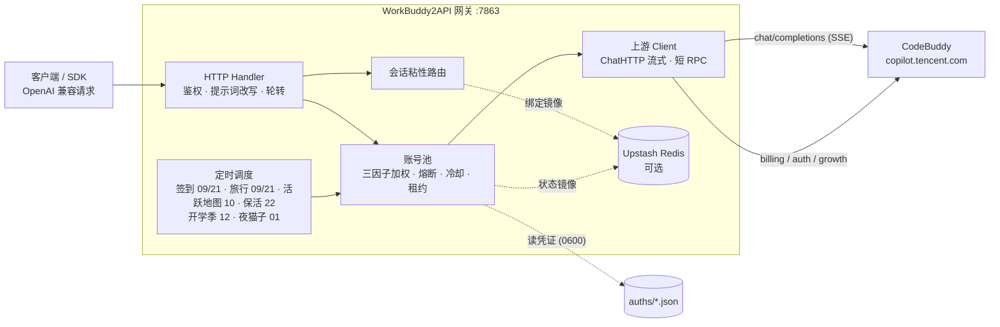

<p align="center">
  
</p>

<h1 align="center">WorkBuddy2API</h1>

<p align="center">
  <b>把 CodeBuddy 账号变成 OpenAI 兼容 API 的多账号网关</b><br>
  OAuth 登录 · 账号池轮转 · 熔断与冷却 · 会话粘性 · 积分补充
</p>

<p align="center">
  
  
  
  
  <a href="https://t.me/sliverkiss_blog"></a>
</p>

---

## 项目简介

WorkBuddy2API 是一个自托管的 **OpenAI 兼容上游网关**，将 ```CodeBuddy``` 账号包装为统一的 `/v1/chat/completions` 服务。

### 交流群组
- [@checkinHome](https://t.me/checkinHome)

### 本项目做什么

- 通过 **OAuth 设备授权**（`login.sh`）获取账号凭证，在网关侧做 token 自动刷新、账号池调度与流量治理；
- 面向 **个人多账号** 场景：多账号共享、单号故障自动换号、冷却 / 熔断防止雪崩、会话粘性保证多轮上下文不跳号；
- 对客户端只暴露 OpenAI 兼容接口，现有 SDK / 前端 / 工具 **零改造接入**。

### 本项目不做什么

- **只做上游网关，不做下游协议转换** — 本项目仅负责对接上游 ```CodeBuddy``` 并暴露 OpenAI Chat 协议；Anthropic Messages、Gemini 等其他协议的适配应由下游网关负责；
- **不内嵌 Web 管理面板** — 网关核心保持精简，可视化面板作为独立项目维护，数据直取上游接口，不增加网关适配负担。

### 社区前端面板

需要 Web 管理面板的用户，可部署以下符合本理念的社区项目（独立维护，与网关解耦）：

- [workbuddy2api-gui](https://github.com/287775856/workbuddy2api-gui) — 账号池状态可视化面板
- [workbuddy-manager](https://github.com/ithtelab/workbuddy-manager) — 账号管理工具

> ⚠️ 合规须知：本项目是**非官方**网关，使用 ```CodeBuddy``` 账号作为上游，**仅限本人授权账号、本机 / 私有环境测试**。详细边界见[安全与合规](#安全与合规)。

📖 完整文档见 [GitHub Wiki](https://github.com/Sliverkiss/workbuddy2api/wiki)。

## 核心能力

### 账号池治理

- **OAuth 设备授权登录** — `login.sh` 一条命令完成：取授权 URL → 浏览器登录 → token 轮询 → 凭证落盘 → 重启加载，全程无 PKCE（state 由服务端签发），重复执行即可连续添加多账号
- **三因子加权随机选号** — `credits 比例 ×10 + 快过期积分占比 ×8 + 闲置补偿` 三项加权（`pool.expiring_soon` 窗口内的积分优先消耗，默认 7 天），按权重降序取 **Top-5 候选短名单**，再在短名单内加权抽签（等权重候选先随机打乱防惊群、LRU 兜底覆盖全部候选），兼顾积分多、快过期积分先用掉、闲置久的账号；失败账号由熔断 / 冷却 / 连败降权状态机处置（不进权重公式）
- **防惊群** — 跳过 100ms 内刚被选中的账号，多账号同时待命时不打爆同一台
- **在途租约** — 单账号最大在途请求数（`pool.max_in_flight`）限制并发占用，占满的号不参与选号，避免单号过载
- **账本择优** — 每次成功请求按 `usage.credit` 折算每千 token 单价记入 `(账号, 模型)` 账本，免费 / 便宜的账号优先；观测按 EMA 平滑、6 小时未更新即失效（陈旧价格不复活），成本随上游活动实时变化；账本随池状态落盘 `state.json`，重启不丢学费；`/status` 透出 `model_costs` 台账（模型 / 单价 / 末次观测 / 样本数）
- **成本分层条件探索** — costTier 硬过滤（免费 > 未知 > 收费）会把全池锁死在唯一的实测免费号上：其余账号永远轮不到、也就永远学不到「它其实也免费」（垄断 + 学习冻结，issue #136）。破解方式是**搭车改道**：tier 0 垄断层存在且 tier 1 有成员时，距上次探索 ≥ `pool.cost_explore_interval`（默认 30m，`"0"` 关停）就把本次选号改道给一个未知号——承接的是完整真实用户请求，**零新增上游请求**（IP 维度零增量，WAF 友好）。成功即毕业（首观测入账，免费回 tier 0 / 收费出局 tier 2，学费只付一次）；失败走既有冷却 / 熔断策略，无探测风暴。探索频率硬性限幅 ≤ 48 次 / 天 / 模型（24h ÷ 30m），与池规模和 QPS 无关；tier 1 枯竭后自动停探。探索节奏按 `(域, 模型)` 独立；`/status` 透出 `cost_explore` 台账（累计事件数 + 各 (域, 模型) 最近探索时刻），与 `model_costs` 行对照即可读出「探索 → 毕业」全链路

### 流量治理

- **分级熔断与冷却** — 429 软冷却（600s 起指数退避、封顶 `soft_rate_max`）、404 固定浅冷却、402 / 余额耗尽硬冷却至次日 04:00、连续失败熔断（`breaker_threshold` 触发后指数退避封顶 6h）
- **模型级限流独立冷却** — 6004（该模型使用量超限）只冷却触发调用的模型，切其他模型立即可用；`/status` 透出 `rate_limited_models` 台账
- **账号临时停用 / 恢复** — 运维可把某个号临时摘出选号池、观察后再放回，不必删凭证（issue #138/#118）。语义是「对话流量摘除」而非「账号冻结」：停用期间签到、token 保活、排程任务照常执行，账号仍在池里、状态照常透出。与系统自动禁用是**两个独立状态位**（`manual_disabled` / `disabled`），各自清除、都清空才回到选号池——避免运维意图被签到解冻等自动复活路径意外解除；停用状态随池状态落盘，重启保留。入口：`/admin/accounts/{uid}/{disable,enable,revive}` 端点 + `cmd/acct` CLI（默认关闭，`admin.enabled` 显式开启）
- **状态持久化** — 池状态（积分 / 冷却 / 熔断 / 计数）本地原子落盘 `state.json`，可选镜像至 Upstash Redis，重启后择优恢复

### 请求链路

- **流式 + 非流式** — 出站强制 `stream:true`；SSE 帧按 OpenAI 规范白名单重建；非流式由本地聚合为单响应
- **DeepSeek 思维链注入** — 出站请求体注入 `thinking.type=enabled` + 默认档位，`reasoning_content` 多轮回填，`reasoning_effort` 按模型档位自动降级
- **系统提示词三模式**（`prompt.mode`，缺省 `passthrough`） —
  - `passthrough`（缺省）：透传客户端原始 system，遇内容拦截自动降级中性提示词重试
  - `custom`：网关用自有提示词**替换**客户端 system/developer（从源头消除模板句误报；不参与降级）
  - `append`：**两者并用**——开头连续 system/developer 块之后插入网关自有提示词，客户端项目规范/工具约定与网关人格共存（issue #129）；降级期与拦截首遇重试时退化为 `custom` 语义（换中性提示词，原文 system 移除）
  - `prompt.file`（custom/append 生效）指向自定义提示词文件，空 = 内置默认
- **会话头族注入** — 出站携带官方客户端会话头族（`X-Conversation-Request-ID` 聚合主键 · `X-Conversation-ID` 透传 · B3 链路），轮转 / 重试 / 路径回退复用同键，后台按对话轮聚合不再碎片化（issue #35）
- **指纹脱敏** — 出站请求体黑名单指纹字段清洗（可开关），与提示词体系两层叠加

### 选号语义

选号 = 会话粘性（命中即定）→ 成本分层（硬过滤）→ 加权随机（软均衡）三层串联，各层语义：

- **成本分层** — 账本把每个 `(账号, 模型)` 归入三档：**tier 0**（实测免费，单价 ≤ 0）、**tier 1**（无观测）、**tier 2**（实测收费）。同一次选号在**存活的最便宜档内**选：有 tier 0 就只在 tier 0 里挑，全池无免费观测才落到 tier 1，再不行才是 tier 2——即「贵号永远只作兜底」。tier 1 的号**不会被跳过**：新账号 / 新模型没跑过就没有观测，直接淘汰会把新号饿死。观测随 `usage.credit` 实时更新且 6 小时过期，所以限免窗口（如夜间免费）一结束，账号回到 tier 1 / tier 2，选号自动跟随——无需重启，日志会打 `free tier ended` 提示价格切换
- **会话粘性** — 同一对话固定走同一账号（多轮上下文不跳号、上游 prompt cache 不碎）。粘性键按此优先级取：**conversation 维度四键**（`metadata.conversation_id` / `metadata.conversationId` / `conversation_id` / `conversationId` 任一）→ **`prompt_cache_key`**（pi-ai 系客户端把会话 ID 放在这个 OpenAI 前缀缓存字段里）→ **首条 user 消息文本的 sha256 兜底**（OpenAI 兼容协议无会话 ID 字段，dsh / Codex 等客户端四键全缺，此前粘性恒不命中、逐请求换号；现由首条 user 消息派生会话级稳定键——会话内历史追加不影响该键，开新会话自然换键）。`user_id` **不是**粘性键——它会把一个用户的所有并行对话钉到同一个号上（粒度远粗于上游对话级缓存边界），发 `user_id` 的客户端回落加权轮换（**该回落同样适用于首条 user 消息兜底**：请求体带 `metadata.user_id` 或顶层 `user_id` 时不派生兜底键）。绑定 30 分钟滚动续期，空闲即过期释放。**首绑按三因子权重分配**（issue #265）：会话第一次绑号时，在「优先未绑定任何会话的空闲号」的候选集里按 `credits ×10 + 快过期积分 ×8 + 闲置补偿` 加权抽取，而不是按 uid 哈希取模——否则带会话标识的请求首轮绑定后一路滚动续期，永远走不到下面的「负载分布」那层，快过期积分在默认配置下就轮不到被优先消耗
- **负载分布** — 粘性与分层都未限定时，三因子加权随机（`credits ×10 + 快过期积分 ×8 + 闲置补偿`）把流量摊开：高余额号多扛、快过期积分的号先用、闲置号补位；防惊群跳过 100ms 内刚选中的号。权重是**概率倾斜**而非硬排序（Top-5 短名单 + 名单内抽签），不会让单一账号垄断流量

### 定时积分任务

六类任务各自独立排程、独立开关（`schedule.*_enabled`），互不影响。时刻写成
**`"HH:MM"` 字符串**（24 小时制，精确到分），一个任务可配多个时刻：

```json
"schedule": {
  "checkin_time":   ["09:00", "21:00"],
  "travel_time":    ["09:00", "21:00"],
  "activity_time":  ["10:00"],
  "keepalive_time": ["22:00"],
  "school_time":    ["12:00"],
  "cat_time":       ["01:00"]
}
```

| 任务 | 默认时刻 | 做什么 |
|---|---|---|
| 签到 `checkin_time` | 09:00 / 21:00 | 每日签到 + 余额查询，余额恢复自动解冻冷却账号 |
| 活跃地图 `activity_time` | 10:00 | 对话事件连发上报点亮活跃地图与连登、解锁领养前置、连登档位兑换 + 抽奖、礼包/补偿领取，回读 streak 自检 |
| 猫猫旅行 `travel_time` | 09:00 / 21:00 | 独立排程：领养 / 派出 / 领奖闭环推进 |
| token 保活 `keepalive_time` | 22:00 | 全账号刷新 token，session 失效连续 3 次才禁用 |
| 开学季 `school_time` | 12:00 | 任务点亮 + claim + 自动抽空抽奖余额，活动下线时自动跳过 |
| 夜猫子 `cat_time` | 01:00 | 夜猫窗口（23:00–08:00 CST）内补一次 black_cat 任务 |

**从旧写法迁移**：老配置里的 `checkin_hours: [9, 21]`（整数小时）仍可用，加载时会折算成
`"09:00"` / `"21:00"` 并在启动日志打一条 WARN 提示；新配置请直接用 `*_time`。
非法值（`"25:00"`、`"09:70"`、`"0930"`、旧小时越界）一律**加载期报错**并指出对应开关。

> 要"关闭某类任务"请设 `*_enabled: false`，不要靠清空时刻数组——空数组/缺省 = 回落默认。

#### 账号之间的随机分布（`schedule.spread_window`，默认 `15m`）

`schedule.*_time` 只给出时点。到点后**不会让所有账号在同一秒发请求**——那样在
服务端看来就是一台机器。调度器把这一批账号摊在一个延迟区间里：

```json
"schedule": {
  "spread_window": "15m"
}
```

`spread_window`：空 = 默认 `15m`；`"0"` = 关闭（回到「到点立刻 + 固定间隔顺序执行」）。

算法：**给定区间 [0, `spread_window`)，每个账号独立取一个均匀随机位置**

- 每个账号的延迟 = `uniform(0, 窗口)` —— 所有样本都落在同一个区间内、位置互不相关；
- 按延迟升序执行，但「哪个账号占哪份延迟」再洗一次牌 → 谁先谁后也不可预测；
- 第一个账号同样要等自己那份随机延迟，所以**整批起点也不在整点**；
- 六类任务同一套算法（签到 / 旅行 / 活跃上报 / 保活 / 开学季 / 夜猫子）；脚本类任务
  （开学季、夜猫子）在定时触发时改为**逐账号起子进程**，各落在自己的时刻。

**同一账号内的连续请求同样有抖动**：签到链路是「刷新 token → 签到 → 查余额」三连、
旅行是「查有无猫 → 查状态 → 派出/领奖」三连——这些背靠背请求之间插入随机间隔，
打断「同号同秒连打」的形态（活跃上报的 N 条之间同理）。区间可配：

```json
"schedule": {
  "intra_request_jitter_min": "1s",
  "intra_request_jitter_max": "3s"
}
```

缺省 **1s ~ 3s**（每次等待取 `uniform[min, max]`）；两个都写 `"0"` 关闭；`min > max` 加载期报错。

排障时可用环境变量临时代替设置项（不改配置文件）：`WB2A_TASK_SPREAD=20m` 改窗口、
`WB2A_TASK_SPREAD=0` 关闭。

> 三者的分工：`schedule.random_delay_minutes` 抖的是**整批起点**在小时内的小偏移（可选）；
> `schedule.spread_window` 是**账号之间**的分布（默认 15m）；`schedule.account_delay_min_seconds/
> max_seconds` 是摊开关闭后账号间的固定/抖动间隔。手动触发（后台「全部签到」、`./signin.sh`、
> `wbctl checkin`）**不摊开**——用户正等着结果，只保留账号内的随机间隔抖动（`intra_request_jitter_*`）。

### 双域适配

- 同时适配**国内版（CN，`copilot.tencent.com` / `www.codebuddy.cn`）与国际版（Global，`www.workbuddy.ai`）**账号
- 共享同一账号池，由账号 `realm` 或请求模型名前缀（`cn:` / `global:`）决定路由；`global.enabled` 可一键锁死纯 CN 部署
- 国际版支持注册激活、地区完善、一次性 trial 加油包领取（`./trial.sh`）

### 辅助工具

- 积分日报：`./credit.sh`（美化 / `-json`，realm 感知双域）
- 手动签到：`./signin.sh`（批量、幂等不重复计）
- 账号停用 / 恢复：`./acct.sh list | disable <uid> [原因] | enable <uid> | revive <uid>`（需 `admin.enabled`，走网关管理端点）
- 成长任务一体机：`./task_runner`（默认 dry-run；`--yes` 才真跑，`--only <kind>` 可只跑一类）
- 开学季 / 夜猫子补跑：`./school_bin`、或 `scripts/school_open_day_cron.sh {school|cat}`
- 账号管理面：`./wbctl accounts | checkin [uid] | login | models | chat --model <m> "…"`
- 个性化提示词：`prompt.file` 指向自定义提示词文件即整体替换内置默认（`custom`/`append` 模式生效）

> 上述工具已全部是 Go 二进制（`internal/growth`、`internal/region` 等实现），镜像里
> **不再需要 python3**。原 `scripts/*.py` 已删除，对应实现见 `internal/growth/`。

## 架构总览



上游请求在出站前经历统一的改写管线（`internal/upstream/payload.go`）：强制 `stream:true`、`developer` 角色归一、tool_choice 归一、`image_url` 字符串兼容为 OpenAI 对象形态、DeepSeek 思维链注入、`reasoning_effort` 档位降级、`reasoning_content` 回填、指纹脱敏。

## 快速开始

### 环境要求

- **Docker + Docker Compose**（推荐部署方式，镜像内已含 `app` 低权限用户与全部工具脚本）
- 一个或多个已注册的 CodeBuddy 账号，用于 OAuth 登录
- 宿主机 Go ≥ 1.22（仅源码构建时需要）

### Docker Compose 一键部署

```bash
git clone https://github.com/workpuppy/workpuppy.git
cd workpuppy
cp config.example.json config.json
```

编辑 `config.json`，**至少设置 `api_key`**（`留空 = 不鉴权`，公网部署务必设置）；要用 Web 管理后台再做 `"admin": {"enabled": true}`。示例中的 `test_key` 等均为占位符，`config.example.json` 不含任何真实密钥。

两种起法，按需选一种：

```bash
# ① 用已发布镜像（推荐；镜像多架构，docker 会按本机架构自动选择）
docker run -d --name workbuddy2api -p 127.0.0.1:7863:7863 \
  -v "$PWD/auths:/app/auths" -v "$PWD/data:/app/data" \
  -v "$PWD/config.json:/app/config.json:ro" \
  ghcr.io/workpuppy/workpuppy:latest

# ② 本地源码构建（改了代码时用）
docker compose up -d --build
```

```bash
# 登录添加账号（重复执行可加多号；注意：执行过下方说明中的 chown 后，
# host 侧 login.sh 会被可写性预检拦截——此时请在容器内登录，见下方说明）
./login.sh

# 健康检查（无可用账号时 503）；service 字段用于确认打到的是本网关
curl -s http://localhost:7863/healthz
# {"healthy":2,"total":3,"service":"workbuddy2api"}

# 管理后台（需 admin.enabled=true；登录密码在启动日志里：docker logs workbuddy2api | grep 登录密码）
curl -sI http://localhost:7863/ | head -1
```

`login.sh` 内置授权 URL 获取 + 浏览器登录 + token 轮询 + 首次签到 + `auths/workbuddy-<uid>.json` 落盘 + 容器重启，全程无 PKCE（state 由服务端签发）。账号池在容器启动时用 `auths/` 目录自动对齐，新增凭证文件即自动发现。

> **非 root 宿主用户注意**：`./login.sh` 以**当前宿主用户**落盘凭证（权限 0600），而容器内网关以 `app(uid 10001)` 读 + 回写（refresh / realm 补标识走 tmp+rename，需要目录写权限）。二者 uid 不同（例如 Linux 非 root 账号通常是 uid 1000）时容器读不到凭证文件，`/status` 账号数为 0——与 `./data` 卷的属主问题同源。登录后、启动前把目录属主交给 10001（root 或部署用户执行）：
>
> ```bash
> chown -R 10001:10001 ./auths
> ```
>
> 之后新增账号**必须**进**容器内**登录（`app` 自身落盘，属主即 10001，无需反复 chown；chown 后 host 侧 `./login.sh` 无写权限，脚本会在启动浏览器授权前直接退出并提示，不会白走一遍 OAuth。容器内无 docker CLI，完成后回宿主机重启）：
>
> ```bash
> docker compose exec -it wb2api bash -c './login.sh' && docker compose restart wb2api
> ```

### 源码构建

```bash
go build ./...
go vet ./...
go test ./...      # 完整测试套件
go run ./cmd/server -config config.json
```

构建二进制（与 Dockerfile 完全一致的清单）：

```bash
CGO_ENABLED=0 go build -trimpath -ldflags="-s -w" -o wb2api       ./cmd/server
CGO_ENABLED=0 go build -trimpath -ldflags="-s -w" -o signin_bin   ./cmd/signin
CGO_ENABLED=0 go build -trimpath -ldflags="-s -w" -o login        ./cmd/login
CGO_ENABLED=0 go build -trimpath -ldflags="-s -w" -o credit       ./cmd/credit
CGO_ENABLED=0 go build -trimpath -ldflags="-s -w" -o trial_bin    ./cmd/trial
CGO_ENABLED=0 go build -trimpath -ldflags="-s -w" -o activity_bin ./cmd/activity
CGO_ENABLED=0 go build -trimpath -ldflags="-s -w" -o task_runner  ./cmd/taskrunner
CGO_ENABLED=0 go build -trimpath -ldflags="-s -w" -o school_bin   ./cmd/school
CGO_ENABLED=0 go build -trimpath -ldflags="-s -w" -o wbctl        ./cmd/wbctl
```

#### 平台支持

本项目**只面向 Linux + Docker 部署**（amd64 / arm64）。Windows 原生运行、`.cmd`
启停脚本与 Windows 安装器均已移除；非 Unix 平台虽仍能编译，但进程没做过验证，
TUI（`cmd/stats`）也会退化为单次输出。

### 验证

```bash
# 模型列表
curl -s http://localhost:7863/v1/models -H "Authorization: Bearer your-api-key"

# 账号状态（汇总 + 每账号详情，含 disabled / manual_disabled 双位）
curl -s http://localhost:7863/status -H "Authorization: Bearer your-api-key"

# 临时停用一个账号（需 config 里 admin.enabled = true）
curl -s -X POST http://localhost:7863/admin/accounts/<uid>/disable \
  -H "Authorization: Bearer your-api-key" -H "Content-Type: application/json" \
  -d '{"reason":"观察几天"}'
# 或用 CLI（自动从 config.json 读网关地址与 key）
./acct.sh list && ./acct.sh disable <uid> 观察几天 && ./acct.sh enable <uid>

# 流式聊天
curl -sN http://localhost:7863/v1/chat/completions \
  -H "Authorization: Bearer your-api-key" \
  -H "Content-Type: application/json" \
  -d '{"model":"deepseek-v4-flash","messages":[{"role":"user","content":"hi"}],"stream":true}'

# 非流式聊天（本地聚合）
curl -s http://localhost:7863/v1/chat/completions \
  -H "Authorization: Bearer your-api-key" \
  -H "Content-Type: application/json" \
  -d '{"model":"deepseek-v4-flash","messages":[{"role":"user","content":"hi"}],"stream":false}'
```

## 开发与提交约定

本仓库的日常协作遵循几条硬约定（目的是让修订记录可追溯、代码状态始终可构建）：

1. **每完成一件事就提交并推送**：不攒工作区；`origin/main` 永远等于「最后一次验证通过的
   状态」。任务结束时的顺序固定是 *改 → 自检 → 提交 → 推送*。
2. **需要澄清的地方先问、改完自动推送**：澄清不阻塞已完成的改动；确认后的修改同样走
   提交 + 推送，不留在本地。
3. **一次提交只表达一件事**：重构、功能、文档、依赖各占一次提交；提交信息写清
   「改了什么 / 为什么 / 怎么验证的」，便于以后 `git log` 追查。
4. **提交前必须自检**，且结果写进提交信息：
   ```bash
   go build ./... && go vet ./... && go test ./...
   # 改到部署相关时再验：
   GOOS=linux GOARCH=amd64 CGO_ENABLED=0 go build ./...
   GOOS=linux GOARCH=arm64 CGO_ENABLED=0 go build ./...
   ```
5. **不把归档目录与运行期数据入库**：`old/`（旧 Python/Next 面板）、`auths/`、`data/`、
   真实 `config.json` 一律由 `.gitignore` / `.dockerignore` 排除；凭据永远不进 git。
6. **不重写已发布的历史**：只有尚未推送的提交才允许 `reset`/重排；推送过的历史只追加。

## CI：镜像构建（GitHub Actions）

流水线文件：`.github/workflows/docker.yml`。**每次提交都自动打包镜像**，也可手动触发。

| 触发 | 平台 | 推送的标签 |
|---|---|---|
| push 到任意分支 | `linux/amd64,linux/arm64` | **`latest`**、`sha-<7位>`、`<分支名>` |
| push `v*` tag | `linux/amd64,linux/arm64` | **`latest`**、`sha-<7位>`、`<tag>` |
| 手动（Actions → docker → Run workflow） | 输入决定（默认双架构） | 同上（可关掉推送只验证） |

**镜像标签以 `latest` 为主**：镜像是一个多架构 index（amd64 + arm64），客户端只写
`:latest` 即可 —— docker / NAS / k8s 会按本机架构自动挑对应 manifest，不需要你判断平台。
需要「固定到某次提交」时用不可变的 `sha-<7位>`。

> index 里**只有** `linux/amd64` 与 `linux/arm64` 两条：流水线显式关掉了 buildx 的
> provenance / SBOM 附件（它们会以 `unknown/unknown` 平台出现在 index 里，老版本 NAS
> 的镜像列表会因此报「unknown platform」）。每次推送后流水线还会用
> `docker buildx imagetools inspect` 反向校验平台齐全、无 attestation 条目。

```bash
# 客户端：一条命令，架构自适配
docker pull ghcr.io/workpuppy/workpuppy:latest

docker run -d --name workbuddy2api -p 127.0.0.1:7863:7863 \
  -v "$PWD/auths:/app/auths" -v "$PWD/data:/app/data" \
  -v "$PWD/config.json:/app/config.json:ro" \
  ghcr.io/workpuppy/workpuppy:latest

# 管理后台：http://127.0.0.1:7863/     （/v1 仍是 OpenAI 兼容入口）
# 需要实名某个提交：ghcr.io/workpuppy/workpuppy:sha-<7位>
```

流水线分两段：

1. **`test`**：`go build` / `go vet` / `go test ./...` —— 测试红了不产出镜像。
2. **`image`**：buildx 构建（GHA 层缓存）→ **真跑一次容器冒烟**（`/healthz` 有应答、
   无 key 访问 `/status` 必须 401、`GET /` 是管理后台且内嵌 Bootstrap 可访问、
   容器内**不允许存在 python3**）→ 推送到 GHCR。

> **首次启用需要一次仓库设置**：`Settings → Actions → General → Workflow permissions`
> 选 **Read and write**（或至少允许 `packages: write`），否则推 GHCR 会 403。

### 关于镜像可见性

仓库 public **不等于** 镜像 public：用 `GITHUB_TOKEN` 发布的 GHCR 包默认 **private**，
且可见性开关**不在仓库设置里**，而在组织级包页面：

```
https://github.com/orgs/<org>/packages/container/<repo>
→ Package settings → Danger Zone → Change visibility → Public
```

若该页提示 *Setting is disabled by organization administrators*，说明被组织/企业策略锁住，
需要到 `organizations/<org>/settings/packages` 或企业的 `Policies → Packages` 放开。
本仓库已把它设为 public，可直接匿名拉取。

## Web 管理后台

打开 `http://<host>:7863/` 就是后台入口 —— **同一个 Go 进程、同一个端口**托管页面与 API，
容器里不需要 nginx，也不需要任何前端构建步骤（没有 npm / node_modules / 打包产物）。

| 路径 | 用途 |
|---|---|
| `/` | 管理后台（Bootstrap 单页，`location.hash` 切视图） |
| `/assets/...` | 内嵌静态资源（Bootstrap 5.3.3 + app.js/app.css） |
| `/v1/*` | **OpenAI 兼容接口**（原样保留，供下游 SDK 使用） |
| `/admin/*` | 管理面 REST（见下一节） |
| `/status`、`/healthz` | 状态与存活探测 |

页面能力（全部直接打 `/admin/*`，无中间层）：

- **概览**：账号总数 / 可用 / 冷却 / 禁用 / 在途占满 / 粘性会话 + 原始 `/status`
- **账号**：列表（状态徽标、积分、在途、凭证有效期、线路与权重）+ 单号签到 / 停用 / 启用 / 复活 + 全部签到
- **模型**：模型中心（描述、上下文、最大输出、思考档位、积分倍率、能力标记），支持过滤
- **测试台**：选模型 → 填提示词 → 流式（SSE）或非流式试跑，可指定 `reasoning_effort`
- **扫码加号**：拿授权 URL → 轮询 → 账号自动落盘并进入账号池（与 `login.sh` 等价）

### 登录：一把每次启动都会变的密码

**没有用户名，也没有会话 Cookie** —— 打开 `/` 是登录页，填一串密码就进去了：

```bash
docker logs workbuddy2api | grep 登录密码
#  登录密码: HDBzN2dnojSNGrpki7UA    （本次启动随机生成）
```

- **每次启动随机生成**（20 字符，crypto/rand），**只存在进程内存里**：重启即换新密码，
  旧密码立即失效；不落盘、不写 `config.json`、不进数据库。
- 打印时机在**端口已绑定之后**（"ready 之后"）：端口占用导致启动失败时，日志里不会
  留下一个看起来能用的密码。
- 想固定密码（开发/自动化）就设环境变量 `WB2A_ADMIN_PASSWORD`（≥8 字符，否则启动失败）。
- 前端把密码存在浏览器 `localStorage`，每个请求带 `Authorization: Bearer <密码>`；
  **密码为空 / 失效（401）时自动清掉本地存储并回到登录页**，不会停在空白面板上。
- 登录失败按来源 IP 限速：5 分钟内 10 次后回 `429`。
- 管理凭据与 `/v1`、`/status` 的 `api_key` **完全分离**：拿下游 key 打 `/admin/*` 一律 401。

> 谁能看容器日志，谁就能进后台 —— 这本来就是同一权限层（能看日志的人已经能控制容器）。
> 反过来说：**不要把容器日志外发给第三方**。

| 路径 | 用途 |
|---|---|
| `/` | 管理后台（Bootstrap 单页，`location.hash` 切视图） |
| `/assets/...` | 内嵌静态资源（Bootstrap 5.3.3 + app.js/app.css） |
| `/v1/*` | **OpenAI 兼容接口**（原样保留，供下游 SDK 使用，`api_key` 鉴权） |
| `/admin/*` | 管理面 REST（管理密码鉴权，见下一节） |
| `/status`、`/healthz` | 状态与存活探测（`/status` 走 `api_key`，`/healthz` 不鉴权） |

页面能力（全部直接打 `/admin/*`，无中间层）：

- **概览**：账号总数 / 可用 / 冷却 / 禁用 / 在途占满 / 粘性会话 + 原始状态 JSON（`/admin/status`）
- **账号**：列表（状态徽标、积分、在途、凭证有效期、线路与权重）+ 单号签到 / 停用 / 启用 / 复活 + 全部签到
- **模型**：模型中心（描述、上下文、最大输出、思考档位、积分倍率、能力标记），支持过滤
- **测试台**：选模型 → 填提示词 → 流式（SSE）或非流式试跑，可指定 `reasoning_effort`
- **扫码加号**：拿授权 URL → 轮询 → 账号自动落盘并进入账号池（与 `login.sh` 等价）

### 选型与实现约束

- **Bootstrap 5.3.3 已 vendored 进仓库**（`internal/webui/assets/`，随二进制 embed），
  改样式就改 `app.css` / `app.js`，`go build` 即生效 —— 没有 `npm install`、没有打包器、
  没有 CI 前端阶段。许可与来源见 `internal/webui/assets/NOTICE.txt`。
- **一切数据都从 REST 拿**：页面不内置任何业务判定（状态分类、能否签到、是否入池都由
  服务端字段决定），所以「界面显示」与「curl 结果」不可能不一致。
- **页面本身不含任何凭据**：登录页可以匿名打开，但每个数据请求都要带管理密码。
- **安全**：响应统一带 CSP（`default-src 'self'`，禁内联脚本与外链）、`nosniff`、
  `frame-ancestors 'none'`；渲染一律 `textContent`，不拼 HTML（账号昵称/描述都是外部输入）。
- **前提**：`config.json` 里 `admin.enabled=true`，否则 `/admin/*` 不注册，页面会提示
  「管理面未开启」。

## 管理面（REST + CLI）

> 本仓库以**上游源码快照为基线**做二次开发（原 Python/Next 可视化面板已归档到 `old/`，
> 二进制不再包含它）。管理能力按「够用就好」重建：Web 后台 + REST 端点 + 命令行客户端。

### 设计边界

- **开关**：`config.json` 的 `admin.enabled`（默认 `false`）。未开启时 `/admin/*` **根本不注册**（回 404），
  而不是 403 —— 后者等于告诉扫描者「这里有管理面，只是没给钥匙」。
- **鉴权**：管理面**只认管理密码**（启动时随机生成、只存内存、打印在终端）。
  与 `/v1`、`/status` 的 `api_key` 彻底分离 —— 下游手里的 key **不能**停号、加号或看全量账号。
- **绝不放行**：凭据未初始化时管理面回 `503`。**没有**「api_key 为空 = 不鉴权」这种默认值
  （数据面沿用上游语义，管理面不沿用）。
- **只读端点不写上游**：`/admin/accounts` 只读池状态与 `auths/*.json`，不刷新 token、不查余额。
  要查余额就签到（它顺带回填积分），或走既有 `/v1/*`。
- **字段契约分开演进**：`/status` 是给**下游 SDK** 看的稳定契约，`/admin/*` 是排障口径
  （token 何时过期、能不能刷新、绑了哪条线路、手写权重）。两套字段互不牵连。

### 端点

| 方法 | 路径 | 说明 |
|---|---|---|
| `POST` | `/admin/login` | 用密码确认身份：`{"password":"…"}` → `{"ok":true}`；错误 401、超限 429（无需用户名） |
| `GET` | `/admin/status` | 与 `/status` 同形，但走管理凭据（后台看池子不必拿下游 key） |
| `GET` | `/admin/accounts` | 账号清单：池运行态（积分/冷却/在途/连败…）+ 凭证元信息（有效期、能否刷新、线路、权重）。**含只在文件里、没进池的账号**（否则「加了号却看不见」无从排查） |
| `GET` | `/admin/accounts/{uid}` | 单账号详情（同上 + 池状态原样） |
| `POST` | `/admin/accounts/checkin` | 全部签到。复用调度器入口，共享它的单飞锁与「相邻账号间隔」；正在跑时回 `409 busy` |
| `POST` | `/admin/accounts/{uid}/checkin` | 单号签到，顺带查余额并回填池；今天已签回 `status:"already"`（幂等，不是失败） |
| `POST` | `/admin/accounts/{uid}/disable` | 摘除对话流量（签到与保活照常），可带 `{"reason":"…"}` |
| `POST` | `/admin/accounts/{uid}/enable` | 解除手动停用 |
| `POST` | `/admin/accounts/{uid}/revive` | 解除**系统自动禁用**（封号救不回，响应里会如实标） |
| `POST` | `/admin/auth/start` | 扫码加号第一步：`{"realm":"cn|global"}` → `{state, auth_url}`，`auth_url` 转二维码即可 |
| `GET` | `/admin/auth/poll` | 轮询 `?state=…&realm=…`：`pending` 或 `saved`（成功即原子写入 `auths/workbuddy-<uid>.json`，池会自动热加载） |
| `GET` | `/admin/models` | 模型中心：名称、中文描述、上下文、最大输出、思考档位、积分倍率、能力标记、版本归属 |
| `POST` | `/admin/playground/chat` | 聊天测试台：**复用 `/v1/chat/completions` 整条链路**（净化/指纹改写/轮转/SSE/错误分类一致），`?uid=` 可指定账号定点验证 |

```bash
# 管理密码在启动日志里（每次重启都会变）
PW=$(docker logs workbuddy2api 2>&1 | sed -n 's/.*登录密码: \([^ ]*\).*/\1/p' | tail -1)

# 先登录确认（也可以跳过，后面直接用这个密码）
curl -s -X POST http://127.0.0.1:7863/admin/login \
  -H "Content-Type: application/json" -d "{\"password\":\"$PW\"}"

# 加号（扫码）
curl -s -X POST http://127.0.0.1:7863/admin/auth/start \
  -H "Authorization: Bearer $PW" -H "Content-Type: application/json" \
  -d '{"realm":"cn"}'          # → {"state":"…","auth_url":"https://…"}
# 扫码后轮询，成功即落盘
curl -s "http://127.0.0.1:7863/admin/auth/poll?state=<state>&realm=cn" \
  -H "Authorization: Bearer $PW"

# 签到 / 定点试模型
curl -s -X POST http://127.0.0.1:7863/admin/accounts/checkin -H "Authorization: Bearer $PW"
curl -s -X POST "http://127.0.0.1:7863/admin/playground/chat?uid=<uid>" \
  -H "Authorization: Bearer $PW" -H "Content-Type: application/json" \
  -d '{"model":"deepseek-v4-flash","messages":[{"role":"user","content":"hi"}]}'
```

### 命令行客户端 `wbctl`

```bash
go build -o wbctl ./cmd/wbctl        # 或用发布包里的 wbctl

# 密码来源：-password 或环境变量 WB2A_ADMIN_PASSWORD（与后台登录用同一串）
export WB2A_ADMIN_PASSWORD=$(docker logs workbuddy2api 2>&1 | sed -n 's/.*登录密码: \([^ ]*\).*/\1/p' | tail -1)

./wbctl accounts                     # 账号清单（-json 出原始 JSON）
./wbctl account <uid>                # 单账号详情
./wbctl checkin                      # 全部签到（省略 uid）
./wbctl checkin <uid>                # 单号签到
./wbctl login --realm cn             # 扫码加号：打印链接、等授权、自动落盘
./wbctl models                       # 模型中心（上下文/输出/档位/积分倍率）
./wbctl chat --model deepseek-v4-flash "你好"        # 测试台
./wbctl chat --model deepseek-v4-flash --uid <uid> --stream "你好"
./wbctl disable <uid> --reason 观察几天
./wbctl enable <uid> ; ./wbctl revive <uid>
```

`wbctl` 默认读 `./config.json`（只为拿 `listen`），管理密码用 `-password` 或环境变量 `WB2A_ADMIN_PASSWORD`。
它**不含业务逻辑**：所有判定都在服务端，因此 `curl` 与 `wbctl` 的行为不可能不一致。

### 这一版**没有**做（与旧的 Python 面板相比）

多密钥分发（配额 / IP 与模型白名单）、请求日志与用量统计落库、多上游分组、PG 异地备份、
页面改版监控、红包、多语言、网页一键更新、Windows 安装器 —— 这些都不在 Go 侧重新实现。
需要其中某项时，建议按同样风格加一个 `/admin/*` 端点 + `wbctl` 子命令，而不是引入新进程或新前端。
旧实现仍完整保留在 `old/` 里，可对照移植。

## 安全与合规

### 发布来源与合规边界

- **CI 自动打包**：GitHub Actions（`.github/workflows/docker.yml`）**每次提交**都构建多架构镜像（amd64/arm64，同一 image index）并推送到 `ghcr.io`，标签以 `latest` 为主、`sha-<7位>` 供追溯；也可本地 `docker compose build` 自构建
- 登录 / 签到 / 积分工具：`./login.sh` / `./signin.sh` / `./credit.sh`
- **无产物校验和**：`go.sum` 仅约束 Go 模块依赖；Docker 镜像由本地 `docker compose build` 生成，未引用第三方镜像
- 上游 CodeBuddy 属第三方商业产品，本项目是其**非官方 OpenAI 兼容网关**；使用其账号做 API 网关涉及目标平台服务条款与账号风险，作者不对账号封禁、条款违约或使用结果负责

### 授权使用边界

- 仅限**本人授权账号**、本机 / 私有环境测试
- 不得共享、转售、违规分发，或用于违反目标平台条款的用途
- 遵守 CodeBuddy 平台服务条款与所在地法律
- 妥善保管 `auths/`（明文凭证）与网关端口

## 免责声明

本项目（包括但不限于代码、脚本、文档、配置示例及仓库内任何资源，下称「本项目内容」）**仅供个人学习与研究使用**。使用本项目表示您已阅读并接受本声明全部条款；如不同意，请立即停止使用并删除全部相关内容。

**1. 用途限制。** 本项目内容仅可用于个人学习、研究等非商业用途；请勿将本项目用于任何商业目的或牟利行为，请勿违反所属国家 / 地区 / 组织的任何法律法规。本项目不构成对任何软件、服务、平台的使用建议或授权。

**2. 账号与数据责任。** 本项目可能涉及个人账号凭证的获取、存储与使用。您应仅使用本人持有且已获授权的账号，自行确认相关平台的服务条款与允许范围，并自行承担使用、存储凭证（如 `auths/` 中的文件）及调用上游服务所产生的全部责任与风险。本项目不参与、不介入您与任何平台之间的契约关系。

**3. 内容与第三方界限。** 本项目内容中引用的第三方产品、服务、LOGO、图片、文案等，其权利均归各自权利人所有；本项目不保证此类内容的准确性、完整性、合法性，亦不代表支持或推荐任何第三方。如实存在侵权情形，请通过 Issues 告知，经核实后本项目会尽快处理。

**4. 无担保与风险自担。** 本项目内容按「现状」提供，不附带任何明示或默示的担保（包括但不限于适销性、特定用途适用性、准确性、不侵权等）。使用本项目（包括直接或间接）所产生的任何风险与后果（包括但不限于账号异常、数据丢失、服务中断、纠纷或损失），均由使用者自行承担，与本项目及其全部贡献者无关。

**5. 责任限定。** 在任何情况下，本项目及其作者、贡献者均不对任何直接、间接、偶然、特殊或后果性损害承担责任，无论该等损害是否基于合同、侵权或其他法律理论，即使已被告知发生该等损害的可能性。

**6. 修改与分发。** 基于本项目源代码进行的任何修改、衍生均系第三方自发行为，与本项目无关，相应后果由该第三方自行承担。本项目内所有资源文件，禁止任何公众号、自媒体进行任何形式的转载、发布。未经授权，任何组织或个人不得将本项目内容用于转载、发布或再分发。

**7. 条款变更。** 本项目保留随时修改、补充本声明的权利。修改后的声明自发布之日起生效，继续使用本项目即视为接受修订后的声明。本项目所有内容仅供学习和研究使用，请于学习研究完成后及时删除。

## ☕ Coffee

如果这个项目对你有帮助，欢迎请我喝杯咖啡～

<table>
  <tr>
    <td align="center"><b>💰 Solana</b></td>
    <td><code>AZAKF74rTu7UFVSNRzsKV4HHpTwarax6cG8KAh4fP5rQ</code></td>
  </tr>
  <tr>
    <td align="center"><b>💎 Ethereum</b></td>
    <td><code>0x1d418627aD6B043900CBE11fe439759bDF2b5170</code></td>
  </tr>
  <tr>
    <td align="center"><b>₿ Bitcoin</b></td>
    <td><code>bc1q9w7h4j9msyd9q6lhl0398n4s3g8h4vchpqvc2k</code></td>
  </tr>
</table>

## 特别感谢
- [@YuJunZhiXue](https://github.com/YuJunZhiXue)

## License

本项目采用 [MIT License](LICENSE) 开源协议。

- 在遵守 MIT License 前提下，允许使用、复制、修改、合并本项目源代码
- 再分发（源码或二进制形式）时，须保留原仓库的 MIT 版权声明与许可声明，并在 NOTICE 或 README 中注明原始出处 `https://github.com/Sliverkiss/workbuddy2api`
- 本项目不授予任何上游（CodeBuddy）接口或服务的权利；使用者仍需自行遵守上游服务条款
- 本项目的使用同时受上方**免责声明**约束；如免责声明与 MIT License 存在不一致，以免责声明为准
