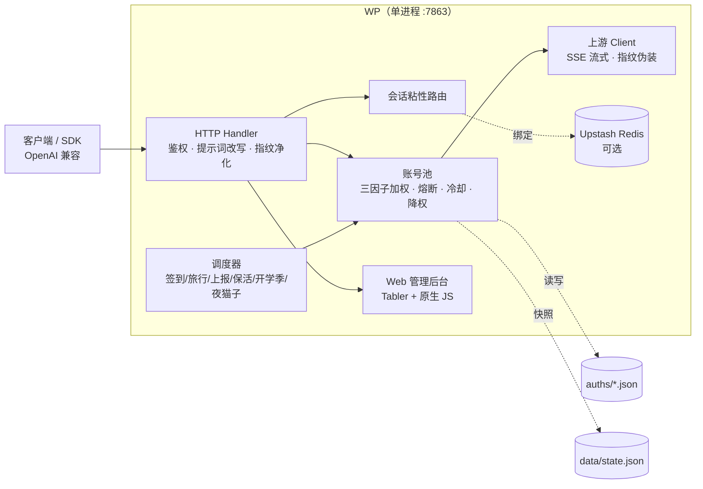

<p align="center">
  
</p>

# WP

把多个 WorkBuddy（CodeBuddy）账号聚合成一个 **OpenAI 兼容** HTTP 网关：下游客户端只需改
`base_url` 与 `api_key`，就能共享整池账号的额度；网关负责鉴权、会话粘性、轮转、冷却、
熔断、指纹改写与定时积分任务，并自带一个只做**账号运营**的 Web 管理后台。

- **单二进制、单端口**：Go 实现（无 Python / 无 Node），同一进程既托管管理页面又提供 API，
  镜像里没有 nginx、没有 npm、没有前端构建产物。
- **一个镜像多架构**：`ghcr.io/workpuppy/workpuppy:latest` 同时含 `linux/amd64` + `linux/arm64`，
  客户端按自己的架构自动选。
- **默认值只有一处来源**：内嵌的 [`config.example.json`](config.example.json)。

---

## 目录

- [特性速览](#特性速览)
- [快速开始](#快速开始)
- [配置说明](#配置说明)
- [客户端接入（/v1）](#客户端接入v1)
- [Web 管理后台](#web-管理后台)
- [管理面 REST API](#管理面-rest-api)
- [命令行客户端 wpctl](#命令行客户端-wpctl)
- [定时任务与账号节奏](#定时任务与账号节奏)
- [双域适配（CN / Global）](#双域适配cn--global)
- [架构总览](#架构总览)
- [目录结构](#目录结构)
- [开发与提交约定](#开发与提交约定)
- [CI 与镜像](#ci-与镜像)
- [排障 FAQ](#排障-faq)
- [许可](#许可)

---

## 特性速览

| 能力 | 说明 |
|---|---|
| OpenAI 兼容 | `/v1/chat/completions`（含 SSE 流式）、`/v1/models`，SDK 直接可用 |
| 多账号池 | 三因子加权随机选号（余额 ×10 + 快过期积分 ×8 + 闲置补偿），概率倾斜而非硬排序 |
| 会话粘性 | 同一对话固定走同一账号（conversation 四键 → `prompt_cache_key` → 首条 user 消息兜底），保护上游前缀缓存 |
| 故障隔离 | 软冷却、硬冷却、熔断（指数退避）、连败降权，401/429/5xx 分类处理，互不叠加取更长者 |
| 指纹伪装 | 伪造官方桌面端 UA / `X-IDE-*` 头组，请求体黑名单指纹脱敏，可配出口线路 |
| 定时积分 | 签到、活跃上报、猫猫旅行、token 保活、开学季、夜猫子六类任务，账号之间随机分布 |
| 管理后台 | 概览 / 账号 / 模型 / 测试台 / 扫码加号，Tabler（内嵌 Bootstrap 5）+ 原生 JS、无前端构建 |
| 管理凭据 | 与 `/v1` 的 `api_key` **完全分离**；首次打开页面时由用户设置，密码以加盐 10 轮 SHA256 的哈希存进 `data/config.json` |
| 观测 | `/status`（给 SDK/监控）、`/healthz` 存活探测、请求指标环形缓冲、可选 Redis 会话镜像 |

---

## 快速开始

### Docker（推荐）

```bash
git clone https://github.com/workpuppy/workpuppy.git
cd workpuppy

# 两个数据目录必须先建好、并交给容器内的 app(uid 10001)：
#   - 镜像里虽然已有 /app/auths、/app/data（属主 app:app），但 -v 绑定挂载会**覆盖**它们；
#   - 宿主目录不存在时由 Docker 以 root 创建，容器内 uid 10001 写不进去。
mkdir -p auths data
sudo chown -R 10001:10001 auths data   # macOS / Windows 的 Docker Desktop 不需要；rootless Docker 也不需要

docker run -d --name wp -p 7863:7863 \
  -v "$PWD/auths:/app/auths" -v "$PWD/data:/app/data" \
  ghcr.io/workpuppy/workpuppy:latest
```

> **不需要再挂载 `config.json`**：首次启动会自动生成 `data/config.json`（内容 = 镜像里的
> `config.example.json`），之后用设置页或直接改这个文件即可。升级也不会覆盖它。
>
> **不建目录 / 不 chown 会怎样**（Linux rootful Docker）：
> - `auths/` 不可写 → 扫码加号落盘失败；token 刷新成功但**回写失败**（重启后还在用旧 token）；
> - `data/` 不可写 → 日志持续刷 `state.json 落盘失败`、`credit-daily 落盘失败`，配置也保存不了；
> - 症状通常表现为"服务能起、面板能开，但账号数一直是 0 或状态不持久"。

### Docker Compose

```bash
mkdir -p auths data && sudo chown -R 10001:10001 auths data   # 同上一节：Linux 必需
docker compose up -d --build        # 或 docker compose up -d（用已发布镜像）
```

### 源码运行

```bash
go build -o wp ./cmd/server
./wp -config data/config.json    # 默认就是 data/config.json；缺失会自动生成
```

### 第一次进来（初始化管理员密码）

```bash
# 1) 浏览器打开管理后台：http://127.0.0.1:7863/
#    首次没有密码，页面会引导你设置一个（至少 8 位）；
#    成功后哈希写入 data/config.json 的 admin.password，并自动开启管理面（无需重启）。

# 2) 添加账号（扫码）
./login.sh
#    在宿主机跑会产生属主为当前用户的文件；Linux 上记得交还给容器用户：
#    sudo chown -R 10001:10001 auths
#    （更省事的做法：docker compose exec -it wp bash -c './login.sh'，容器内落盘属主天然是 10001）
```

> **忘记管理密码**：删掉 `data/config.json` 里的 `admin.password` 字段并重启容器，
> 页面会回到"初始化"状态，重新设置即可（管理面的其它配置不受影响）。
>
> **首次生成到初始化完成之间没有密码保护**：`/admin/setup` 只在"尚未初始化"时可用，
> 但这也意味着任何先连上的人都能设密码。部署到公网时请在初始化完成前限制访问来源，
> 或者先在本机初始化、再把 `data/` 带到服务器。
>
> **首次生成的 `api_key` 是占位符 `test_key`**：记得在「设置」页或文件里换成自己的随机串，
> 否则 `/v1` 等于不鉴权。

---

## 配置说明

> **写错键名会被点名**：配置里出现 `config.example.json` 中不存在的键（拼错、多打字、**改过名的旧键**）
> 不会导致启动失败，但**启动日志会把它们列出来**，避免"以为配了其实没生效"：
>
> ```
> WARN: 配置里有未知键（会被忽略，多半是拼错）：pool.max_in_flight_glboal；全部可用键见 config.example.json
> ```
>
> 改名/退役不做兼容垫片：例如 `admin.random_password_length` 已随"随机密码"方案一起移除，
> 写旧名只会在日志里被点名，不会静默生效。

配置模板是 [`config.example.json`](config.example.json)，**它就是全部默认值的权威来源**
（编译进二进制；仓库根目录那份是同步副本，改完执行 `go run ./cmd/config-default -write`）。

### 开箱即用，只需改 `api_key`

首次启动会生成 `data/config.json`（完整内容 = `config.example.json`）。默认值全部可用，
唯一强烈建议改的是 `api_key`（默认占位符 `test_key`，等于 `/v1` 不鉴权）：

```json
{
  "api_key": "换成你自己的随机串"
}
```

| 键 | 为什么 |
|---|---|
| `api_key` | 下游调 `/v1/*`、`/status` 的凭据。**留空 = 不鉴权**，公网部署务必设置 |

`admin.enabled` 不用手动处理：首次在页面初始化管理员密码时，服务端会把它置为 `true`
（之后也可以在设置页关掉，但关掉后设置页本身也会 404，只能改文件恢复）。

账号**不在配置里**：扫码加号，或把 `workbuddy-<uid>.json` 丢进 `auth_dir`（默认 `./auths`），几秒内自动热加载。

按需再加的常见项（与上面那段合并即可；这里没写的键仍然用默认值）：

```json
{
  "listen": ":7863",
  "auth_dir": "./auths",
  "state_file": "./data/state.json",
  "upstash": { "url": "https://xxx.upstash.io", "token": "…" },
  "schedule": { "travel_enabled": false, "activity_report_count": 5 }
}
```

- `listen`：容器内用 `:7863`，宿主机 `-p 7863:7863` 暴露；改端口只改这一处。
- `upstash`：留空 = 纯内存 + 本地文件，单机部署不需要；配了才会镜像粘性会话与状态快照。
- `schedule`：想关掉某类任务用 `*_enabled`（默认全开）；**清空时刻数组不是关闭**，会回落默认时刻。

服务读取配置的路径：`cmd/server -config <path>`（默认 `data/config.json`）→ 见下方"读取优先级"。

### 读取优先级（与 Spring 的属性覆盖一致）

```
内置默认配置 config.example.json  ←  data/config.json 逐属性覆盖  ←  WP_* 环境变量
```

| 情况 | 结果 |
|---|---|
| 键写了 | 用 `data/config.json` 里的值（写 `0` / `""` / `false` 也算写了） |
| 键没写，或写成 `null` | 用 `config.example.json` 里的值（`null` 视为"未定义"） |
| `data/config.json` 不存在 | **首次启动自动生成**（内容 = `config.example.json`，权限 `0600`），之后不会覆盖 |
| `data/config.json` 存在但不是合法 JSON / 值非法 | 启动失败，错误信息点名配置项 |
| 升级前的旧 `./config.json` | **不会自动迁移**（按需求）：需要时手工把内容搬到 `data/config.json` |

启动日志会打印 `配置来源: …`，一行就能确认到底读了哪个文件。

> **设置页保存 = 写 `data/config.json`**：除了「启用管理面」与「密码强度」即时生效，
> 其余配置都要**重启容器**后生效；保存成功后页面顶部会出现"待重启"横幅，重启后自动消失。

### 顶层

| 键 | 类型 | 默认 | 说明 |
|---|---|---|---|
| `listen` | string | `":7863"` | 监听地址。容器内用 `:7863`，宿主机用 `-p 7863:7863` 暴露端口 |
| `api_key` | string | `"test_key"` | **数据面**密钥：下游调 `/v1/*`、`/status` 时 `Authorization: Bearer <api_key>`。留空 = 不鉴权（公网部署务必设置） |
| `auth_dir` | string | `"./auths"` | 账号凭据目录（`workbuddy-<uid>.json`），新增文件几秒内自动热加载 |
| `state_file` | string | `"./data/state.json"` | 池状态快照（积分/冷却/禁用等），重启后恢复。同目录另有 `credit-daily.json`（积分日账本，保留 30 天） |
| `qrcode_ttl` | string | `"15m"` | **扫码加号二维码的有效期**（不是管理后台的会话超时——管理密码是持久化的，没有会话）。到点后台把二维码标「已失效」、链接加删除线并停止轮询 |
| `proxies` | object\|null | `null` | 出口线路映射，如 `{"hk": "http://127.0.0.1:7890"}`；账号文件里按线路名绑定 |
| `reasoning_as_content` | bool | `true` | 思考兜底：整轮既无正文也无工具调用时，把 `reasoning_content` 同时作为 `content` 下发（避免空回复）。同时渲染两字段的客户端会看到重复，遇到就设 `false` |

### `cooldown` —— 冷却时长

| 键 | 默认 | 说明 |
|---|---|---|
| `soft_rate` | `"600s"` | 软限流（429）冷却基数，指数退避的起点 |
| `soft_rate_max` | `"2h"` | 软冷却指数退避封顶 |
| `credit_exhausted` | `""` | 积分耗尽后的冷却时长（如 `"10m"`）。空 = 冷却到次日 04:00（等签到恢复积分） |
| `not_found` | `"60s"` | 404 / 未知模型的冷却 |
| `waf_base` | `"60s"` | WAF 403（风控）冷却基数 |
| `upstream_restriction` | `"45m"` | 上游限制类错误（地区/权限受限）的冷却 |

### `schedule` —— 定时任务与账号节奏

**执行时刻**：六类任务各一组，值是 `"HH:MM"` 字符串数组（24 小时制，可精确到分，可配多个）。

| 键 | 默认 | 任务 |
|---|---|---|
| `checkin_time` | `["09:00","21:00"]` | 每日签到 + 查余额（余额恢复自动解冻冷却账号） |
| `travel_time` | `["09:00","21:00"]` | 猫猫旅行：领养 / 派出 / 领奖 |
| `activity_time` | `["10:00"]` | 活跃上报（点亮连登、解锁领养前置、连登奖励与抽奖） |
| `keepalive_time` | `["22:00"]` | token 保活刷新 |
| `school_time` | `["12:00"]` | 开学季任务（活动下线自动跳过） |
| `cat_time` | `["01:00"]` | 夜猫子任务（23:00–08:00 CST 窗口内补一次） |

**开关**（关闭某类任务请用这里；清空时刻数组 = 回落默认，不是关闭）：

| 键 | 默认 | 说明 |
|---|---|---|
| `checkin_enabled` | `true` | 关掉签到 |
| `travel_enabled` | `true` | 关掉猫猫旅行 |
| `activity_enabled` | `true` | 关掉活跃上报 |
| `keepalive_enabled` | `true` | 关掉 token 保活 |
| `school_enabled` | `true` | 关掉开学季任务 |
| `cat_enabled` | `true` | 关掉夜猫子任务 |

**节奏与随机分布**（避免"一眼机器"的特征）：

| 键 | 默认 | 说明 |
|---|---|---|
| `activity_report_count` | `5` | 每次活跃上报连发多少条（领猫前置需 5 次对话） |
| `spread_window` | `"15m"` | **账号之间**的随机分布：定时触发时每个账号的执行时刻 = 时点 + `uniform(0, 窗口)`。`"0"` = 关闭（回到固定间隔顺序执行） |
| `intra_request_jitter_min` | `"1s"` | **同一账号**相邻请求之间的随机间隔下限（签到「刷新 → 签到 → 查余额」等） |
| `intra_request_jitter_max` | `"3s"` | 上述间隔上限（`min > max` 加载期报错；两者都 `0` = 关闭） |
| `random_delay_minutes` | `0` | **整批起点**在小时内的小幅抖动（0–60 分钟）；`0` = 严格按时点 |
| `checkin_account_delay` | `"3s"` | 签到相邻账号最小间隔（3 个号 3 秒内连打会被上游 `10001` 拒） |
| `travel_account_delay` | `"800ms"` | 猫猫旅行相邻账号间隔 |
| `activity_account_delay` | `"800ms"` | 活跃上报相邻账号间隔 |
| `checkin_retry_delays` | `["5s","15s","60s"]` | 签到瞬时失败（HTTP 5xx / code 10001）的退避序列；`[]` = 不重试 |
| `checkin_refresh_skew` | `"10m"` | 签到前多久判定 token 将过期并预刷新 |
| `wakeup_grace` | `"5s"` | 睡眠唤醒后、补跑错过的槽位前的网络宽限 |
| `catchup_window` | `"24h"` | 补跑窗口：早于 `now-窗口` 的槽位不再补跑（关机几天不重放） |
| `account_delay_min_seconds` | `0` | 账号间额外抖动下限（秒），叠加在上述基线上 |
| `account_delay_max_seconds` | `0` | 账号间额外抖动上限（秒）；`>0` 时同时把同类任务串行化 |

### `admin` —— 管理面

| 键 | 默认 | 说明 |
|---|---|---|
| `enabled` | `false` | 是否开放 `/admin/*`。首次初始化密码时会**自动置 true**；关掉后设置页自己也会 404（只能改文件恢复） |
| `body_limit_bytes` | `8192` | 管理面请求体上限 |
| `min_password_length` | `8` | 初始化/修改管理密码时的**最小**长度（点保存后即时生效） |
| `password` | 空 | 管理密码的哈希（`sha256x10$<salt>$<digest>`，加盐 10 轮 SHA256）。由页面写入，**不要手写**；删掉它并重启 = 回到初始化状态 |


> 管理密码与 `api_key` 完全分离：拿下游 key 打 `/admin/*` 一律 401。
> 管理面未初始化时接口回 **428**，前端据此显示"初始化密码"向导；
> 密码只以哈希落盘，明文既不打印也不存储；改密需先登录（Bearer 就是旧密码）。

### `global` —— 国际版路由

| 键 | 默认 | 说明 |
|---|---|---|
| `enabled` | `true` | 是否允许 `realm=global` 账号按国际版路由；`false` = 纯 CN 锁定（逃生门） |
| `chat_base` | `""` | 国际版对话 base；空 = 默认 `https://www.workbuddy.ai` |
| `billing_base` | `""` | 国际版计费/任务 base；空 = 同上 |

### `upstream` —— 上游客户端

| 键 | 默认 | 说明 |
|---|---|---|
| `rpc_timeout_seconds` | `120` | **短 RPC**（refresh / 签到 / 查余额 / 拉模型）总时长上限；聊天流不受它约束 |
| `header_timeout_seconds` | `0` | 聊天 SSE **响应头**上限；`<=0` 回落 `rpc_timeout_seconds` |
| `idle_timeout_seconds` | `0` | 聊天 SSE **流中空闲**上限（活跃吐数据会续命）；`<=0` 回落 300 秒 |
| `user_agent` | `""` | 固定 UA；空 = 由 `client_version` + `cli_version` 拼出官方形态 |
| `client_version` | `"5.5.4"` | 伪造的客户端版本（进 UA 与 `X-IDE-*` 头） |
| `cli_version` | `"2.137.1"` | 伪造的 CLI 版本 |
| `device_token` | `""` | 全局 `X-Device-Token`（可选，容器内无桌面端 SDK 时的注入入口） |
| `device_token_file` | `""` | device token 文件路径；空 = 不读 |
| `device_token_ttl` | `"5m"` | 上述文件内容的缓存有效期 |
| `device_token_max_len` | `1024` | 上述文件的最大字节数（超限忽略，优雅降级） |
| `client_name` | `"WorkBuddy"` | `X-Product` / `X-IDE-Name` / `X-IDE-Type` 的取值；`"SaaS"` = 只发 `X-Product`，不带 `X-IDE-*` |
| `passthrough_ip` | `false` | 是否把客户端 IP（`X-Forwarded-For` / `X-Real-IP` 首段）透传给上游 |
| `gzip_body` | `true` | 大请求体是否压缩后上传（省出口带宽） |
| `gzip_threshold_bytes` | `65536` | 超过该字节数才压缩 |
| `retry_after_max` | `"2h"` | 上游 `Retry-After` 的合理上限（超出视为脏数据） |
| `refresh_io_timeout` | `"30s"` | token 刷新的单独超时 |

### `features` —— 请求体净化

| 键 | 默认 | 说明 |
|---|---|---|
| `sanitize_blacklist_fingerprints` | `true` | 出站请求体黑名单指纹脱敏；`false` 完全还原（排障用） |
| `sanitize_extra_features` | `null` | 运行期追加的"特征预检串"：任一命中即进入净化。上游黑名单逐词扩充，放这里不必重编译 |
| `sanitize_extra_rewrites` | `null` | 运行期追加的改写规则列表（如 `{"from":"…","to":"…"}`） |

### `prompt` —— 系统提示词处理

| 键 | 默认 | 说明 |
|---|---|---|
| `mode` | `"passthrough"` | `passthrough` 原样透传客户端 system；`custom` 用 `file` 整体替换；`append` 在客户端 system 后追加 |
| `file` | `""` | `custom` / `append` 模式下的提示词文件路径 |

### `upstash` —— 会话镜像（可选）

| 键 | 默认 | 说明 |
|---|---|---|
| `url` | `""` | 空 = 纯内存模式；支持 `rediss://default:<token>@host:6379` 或 `https://xxx.upstash.io` |
| `token` | `""` | `url` 不是完整连接串时用它拼 `rediss://` |
| `key_ttl` | `"168h"` | 会话镜像 key 的存活时间 |
| `write_concurrency` | `8` | 并发写入上限 |

### `pool` —— 账号池

| 键 | 默认 | 说明 |
|---|---|---|
| `max_in_flight` | `3` | 单账号最大在途请求数；`0` = 不限 |
| `max_in_flight_global` | `2` | 国际版单账号在途上限（WAF 更严，压低并发） |
| `credit_floor` | `0` | 保底积分：低于该值的账号只作最后候选；`0` = 关闭 |
| `breaker_threshold` | `3` | 连续失败多少次触发熔断 |
| `breaker_cooldown` | `"30m"` | 熔断冷却基数（指数退避） |
| `breaker_cooldown_max` | `"6h"` | 熔断冷却封顶 |
| `degrade_threshold` | `5` | 连败降权：连续多少次失败后临时移出候选 |
| `degrade_cooldown` | `"10m"` | 降权时长（固定，非指数） |
| `degrade_cooldown_max` | `"2h"` | 降权时长上限钳制 |
| `idle_weight_per_hour` | `0.5` | 闲置补偿：每小时未使用 +0.5 权重 |
| `idle_weight_max` | `5` | 闲置补偿权重封顶 |
| `expiring_soon_window` | `"168h"` | 快过期积分**窗口**：到期时间在窗口内的积分优先消耗 |
| `expiring_weight` | `8` | 快过期积分在选号权重里的倍数 |
| `min_pick_gap` | `"100ms"` | 选号防惊群：跳过刚被选中的账号 |
| `session_dead_threshold` | `3` | 连续多少次 `12153 session dead` 才禁用账号 |
| `rotation_backoff_base` | `"500ms"` | 换号前的退避基数（对齐官方 CLI） |
| `cost_explore_interval` | `"30m"` | costTier 探索窗口（破除单一账号垄断）；`"0"` 关停 |
| `large_request_bytes` | `2097152` | 大上下文请求阈值（字节，默认 2 MiB） |
| `large_request_cooldown` | `"0s"` | 大请求逐请求轮换的冷却窗口；`"0s"` = 关闭该机制 |
| `large_request_budget` | `6` | 大请求预算：滑动窗口内某号承接达到该条数后换号 |
| `large_request_budget_window` | `"120s"` | 上述预算的滑动窗口 |

### `auths` / `state` / `risk` / `metrics` / `debug` / `models`

| 键 | 默认 | 说明 |
|---|---|---|
| `auths.watch_interval` | `"5s"` | `auth_dir` 热加载轮询间隔（新增账号文件几秒内生效） |
| `state.flush_interval` | `"5s"` | **关键状态**（禁用/休养/签到日/冷却/熔断/刷新风控）落盘间隔，即"变化到落盘"的上界 |
| `state.soft_flush_interval` | `"30s"` | **软计数**（余额的请求内插估算、成功/失败计数、模型成本台账）的合并落盘间隔；这些数据丢一段不影响判定，与关键状态一起写会白增写放大 |
| `state.credit_flush_interval` | `"30s"` | 积分日账 `credit-daily.json` 的落盘间隔（日粒度数据，日末余额可由上游重查） |
| `risk.waf_window` | `"60s"` | 单 IP 的 WAF 命中统计窗口 |
| `risk.waf_threshold` | `2` | 窗口内命中多少次进入"风险暂停"（暂停期间不刷新 token、不跑任务） |
| `metrics.capacity` | `512` | 请求指标环形缓冲容量 |
| `debug.dump_min_bytes` | `4194304` | 请求体落盘排障的最小字节数（`0` = 关闭） |
| `models.default_context_window` | `1000000` | 模型未声明上下文窗口时的兜底值（单位 token） |
| `models.catalog_timeout` | `"5s"` | 上游模型目录抓取超时 |
| `models.catalog_refresh_cooldown` | `"5m"` | 模型目录抓取冷却 |
| `models.catalog_negative_ttl` | `"24h"` | 抓取失败的负缓存 TTL |

### `session_sticky` —— 会话粘性

| 键 | 默认 | 说明 |
|---|---|---|
| `enabled` | `true` | 是否启用会话粘性（同一对话固定同账号） |
| `ttl` | `"30m"` | 绑定空闲过期时间（每次命中滚动续期） |
| `gc_interval` | `"5m"` | 过期绑定清理周期 |

### 环境变量覆盖（最高优先级）

| 变量 | 覆盖的配置项 |
|---|---|
| `WP_LISTEN` | `listen` |
| `WP_API_KEY` | `api_key` |
| `WP_AUTH_DIR` / `WP_STATE_FILE` | `auth_dir` / `state_file` |
| `WP_PROXIES` | `proxies`（`name=url,name=url`） |
| `WP_REASONING_AS_CONTENT` | `reasoning_as_content` |
| `WP_SOFT_RATE` / `WP_SOFT_RATE_MAX` / `WP_CREDIT_EXHAUSTED` | `cooldown.*` |
| `WP_TIMEOUT_SECONDS` / `WP_HEADER_TIMEOUT_SECONDS` / `WP_IDLE_TIMEOUT_SECONDS` | `upstream.*` 超时 |
| `WP_USER_AGENT` / `WP_CLIENT_VERSION` / `WP_CLI_VERSION` / `WP_CLIENT_NAME` | 指纹相关 |
| `WP_DEVICE_TOKEN` / `WP_DEVICE_TOKEN_FILE` | device token |
| `WP_PASSTHROUGH_IP` / `WP_GZIP_BODY` | 透传 IP / 压缩 |
| `WP_PROMPT_MODE` / `WP_PROMPT_FILE` | `prompt.*` |
| `WP_SANITIZE_FINGERPRINTS` | `features.sanitize_blacklist_fingerprints` |
| `WP_EXPIRING_SOON_WINDOW` | `pool.expiring_soon_window` |
| `WP_ADMIN_ENABLED` | `admin.enabled` |
| ~~`WP_ADMIN_PASSWORD`~~ | **已移除**：管理密码改为页面首次初始化，哈希存在 `data/config.json` |
| `WP_TASK_SPREAD` | 临时覆盖 `schedule.spread_window`（`"0"` 关闭），排障用 |
| `WP_TASK_BIN_DIR` | `school_bin` / `task_runner` 等辅助二进制的目录 |
| `TZ` | 容器时区（建议 `Asia/Shanghai`） |

---

## 客户端接入（/v1）

| 路径 | 方法 | 说明 |
|---|---|---|
| `/v1/chat/completions` | POST | OpenAI 兼容对话补全，支持 `stream: true`（SSE） |
| `/v1/models` | GET | 模型清单 |
| `/status` | GET | 池状态（可用账号数、冷却、积分汇总），给下游/监控 |
| `/healthz` | GET | 存活探测（无健康账号时回 503，语义是"活着但不可服务"） |

```bash
curl -s http://127.0.0.1:7863/v1/chat/completions \
  -H "Authorization: Bearer $API_KEY" -H "Content-Type: application/json" \
  -d '{"model":"deepseek-v4-flash","messages":[{"role":"user","content":"hi"}]}'
```

**选号策略**（自动生效，无需配置）：会话粘性优先 → 三因子加权随机（余额 ×10 + 快过期积分 ×8
+ 闲置补偿）→ 排除冷却/熔断/降权/在途已满的账号 → 防惊群跳过刚选中的号。

模型前缀 `cn:` / `global:` 可显式指定域；`/status` 与 `/v1` 共用 `api_key`。

---

## Web 管理后台

打开 `http://<host>:7863/`：**首次**会引导设置管理员密码（无用户名），之后就是登录页。

```bash
# 不记得密码了？删掉 data/config.json 里的 admin.password 字段并重启 → 回到初始化状态
docker compose restart wp
```

| 页面 | 能做什么 |
|---|---|
| 概览 | 账号总数 / 可用 / 冷却 / 禁用 / 在途占满 / 粘性会话 + **积分总计四卡**（当前总积分额度、当日总获得 / 总消耗 / 总调整）+ **积分日账本**（今日赚/花/调整/净 + 近 30 天）+ 网关状态（默认折叠，排障用）；后端返回的原始状态 JSON 也在这里 |
| 账号 | 顶部三个动作：**一键签到**（跳过今天已签）/ **一键猫猫旅行**（补自动任务）/ **刷新余额**（上游只读）；列表（昵称、UID、状态、今日已签、积分、在途、凭证、线路、权重）+ 行内 禁用 / 启用 / 休养；**点每行第一列的昵称** 弹出该号近 7/15/30 天积分曲线（日终总积分 / 当日获得 / 当日消耗 / 当日调整，缺记录的日期按 0） |
| 模型 | 模型中心：描述、上下文、最大输出、思考档位、积分倍率、能力标记 |
| 测试台 | 选模型 → 填提示词 → 流式或非流式试跑（复用 `/v1` 整条链路） |
| 扫码加号 | 选域名 → 拿授权链接 → **页面直接显示二维码 + 有效期倒计时**（也可复制链接）→ 轮询 → 账号自动落盘并进入池；过期后链接打删除线、二维码盖「已失效」遮罩 |
| **设置** | 全部配置项的分组表单（14 组 / 100+ 项）：前端即时校验 + 后端字段级校验；单字段 / 整组 / 全部恢复默认；敏感项（api_key、token）默认掩码、可点眼睛看明文；保存后写盘并在顶部挂「重启容器后生效」横幅；另有「修改管理员密码」 |

**边界**：后台只管账号运营与自身配置，**不影响正在运行的进程**：设置页保存只写
`data/config.json`，除「启用管理面」「密码强度」外都要重启容器才生效（横幅会一直挂着，
直到进程重启）。浏览器把密码存在 `localStorage`，收到 401 或本地为空时自动清掉并回登录页。
页面响应带 CSP（`default-src 'self'`）、`nosniff`、`frame-ancestors 'none'`，
渲染一律 `textContent`（账号昵称等外部输入不进 HTML）。

---

## 管理面 REST API

凭据是**管理密码**（不是 `api_key`）：`Authorization: Bearer <密码>`。登录失败按 IP 限速
（5 分钟 10 次后 429）；密码未初始化时管理面回 **428**（前端据此显示初始化向导）。

| 方法 | 路径 | 说明 |
|---|---|---|
| `GET` | `/admin/setup/status` | **匿名**：`{initialized, admin_enabled, min_password_length}`，首屏据此决定"初始化/登录" |
| `POST` | `/admin/setup` | **匿名**（仅未初始化时可用）：`{"password":"…","confirm":"…"}` → 写哈希 + 自动 `admin.enabled=true`，即时生效 |
| `POST` | `/admin/password` | 改密（Bearer = 旧密码）：`{"password":"新","confirm":"新"}` |
| `GET` | `/admin/config` | 配置：`values`（生效值，不含密码哈希）+ `defaults` + `schema` + `meta`（路径/可写/待重启/初始化状态） |
| `PUT` | `/admin/config` | 深合并保存：`{"values":{…}}`；字段级校验失败回 400 + `error.fields[]` |
| `POST` | `/admin/config/reset` | 恢复默认：`{"scope":"fields","paths":[…]}` / `{"scope":"section","section":"pool"}` / `{"scope":"all"}`；`admin.enabled` 与密码哈希不会被清 |
| `POST` | `/admin/login` | 验密码：`{"password":"…"}` → `{"ok":true}`；401 / 429 / 428 |
| `GET` | `/admin/status` | 与 `/status` 同形，但走管理凭据 |
| `POST` | `/admin/accounts/refresh` | **刷新余额**：逐账号打上游只读 `billing` 接口回写积分（导入的号首次刷新后才有值）；串行 + 间隔，单飞防重入 |
| `POST` | `/admin/travel/run` | **一键猫猫旅行**：手动补一次自动计划任务（领养 / 派出 / 领奖），异步执行回 202。无猫账号会**先补齐领养前置的对话量上报**（同日已发过则跳过），再领养——不再出现"点了按钮却因为 `chat_5` 未满而 400" |
| `GET` | `/admin/accounts` | 账号清单：池运行态 + 凭证元信息（含未入池的账号文件） |
| `GET` | `/admin/accounts/{uid}` | 单账号详情 |
| `POST` | `/admin/accounts/checkin` | **一键签到**：自动跳过今天已签到的账号（签到状态持久化在 `state.json`），与调度器共享单飞锁，忙时 409 |
| `POST` | `/admin/accounts/{uid}/disable` | **禁用**：不接下游流量，且签到 / 活跃上报 / 旅行 / 保活**全部不跑**；可带 `{"reason":"…"}`。系统判定（连续 12153 等）与手动禁用共用同一个 `disabled` 位，`disabled_source` 区分来源 |
| `POST` | `/admin/accounts/{uid}/enable` | **启用**：唯一解除入口，手动与系统禁用一并解除（连续 12153 计数清零），响应里如实带原禁用原因 |
| `POST` | `/admin/accounts/{uid}/rest` | **休养**：不接下游流量，但签到 / 活跃上报 / 旅行 / 保活照跑（凭证与积分都是活的，即"养号"）；持久化，重启保留。**想长期闲置但保持活性请用它，而不是禁用** |
| `POST` | `/admin/accounts/{uid}/unrest` | 解除休养，恢复接流 |
| `GET` | `/admin/credit-daily` | 积分日账本：`totals`/`accounts` 是**当日内存热值**，`histories` 是落盘的每日汇总（保留 30 天，每账号 `earned/spent/adjust/credits_end`）；`?days=N` 控制历史条数 |
| `POST` | `/admin/auth/start` | 扫码加号第一步：`{"realm":"cn\|global"}` → `{state, auth_url}` |
| `GET` | `/admin/auth/poll` | 轮询 `?state=…&realm=…`：`pending` / `saved` |
| `GET` | `/admin/qr` | 把任意文本渲成 PNG 二维码：`?text=<url>&size=240`（扫码加号的 auth_url 就用它；需管理凭据，输出 `no-store`） |
| `GET` | `/admin/models` | 模型中心数据 |
| `POST` | `/admin/playground/chat` | 测试台（`?uid=` 可指定账号定点验证） |

```bash
PW='你在页面初始化时设置的密码'
curl -s -X POST http://127.0.0.1:7863/admin/accounts/checkin -H "Authorization: Bearer $PW"
```

---

## 命令行客户端 wpctl

```bash
go build -o wpctl ./cmd/wpctl
export WP_ADMIN_PASSWORD='你在页面初始化时设置的密码'

./wpctl accounts                 # 账号清单（-json 出原始 JSON）
./wpctl account <uid>            # 单账号详情
./wpctl checkin                  # 一键签到（自动跳过今天已签的）
./wpctl disable <uid> [原因]     # 禁用：不接流量，签到/保活等自动任务全部停止
./wpctl enable <uid>             # 启用（手动/系统禁用一并解除）
./wpctl travel                   # 一键猫猫旅行（领养/派出/领奖）
./wpctl refresh                  # 刷新所有账号余额（上游只读）
./wpctl rest <uid>               # 休养：不接下游流量，自动任务照跑
./wpctl unrest <uid>             # 解除休养
./wpctl credits [天数]           # 积分日账本（默认 7 天）
./wpctl models                   # 模型中心
./wpctl chat --model <m> "…"     # 试跑
./wpctl login --realm cn         # 扫码加号
```

其他辅助命令：`./signin.sh`（批量签到）、`./credit.sh`（积分日报）、`./trial.sh`（国际版激活）、
`./acct.sh`（禁用/启用/清单）、`./task_runner`、`./school_bin`。

---

## 定时任务与账号节奏

六类任务各自独立排程（时刻见上面 `schedule` 一节）。三层节奏避免"一眼机器"的特征：

| 层 | 配置 | 作用 |
|---|---|---|
| 整批起点 | `random_delay_minutes` | 整批在小时内的小幅偏移（可选） |
| 账号之间 | `spread_window`（默认 15m） | 每个账号的时刻 = 时点 + `uniform(0, 窗口)`，按延迟升序执行，账号与时刻的对应关系再洗牌 |
| 账号之内 | `intra_request_jitter_min/max`（默认 1s–3s） | 同一账号的连续请求之间随机等待（签到「刷新 → 签到 → 查余额」等） |

- **手动触发不摊开**：后台「全部签到」/`signin.sh`/`wpctl checkin` 立即执行（用户在等结果），
  只保留账号内随机间隔。
- 脚本类任务（开学季、夜猫子）在定时触发时**逐账号起子进程**，各落在自己的时刻。
- 机器睡眠/关机跨过的槽位会在 `catchup_window` 内补跑；更老的槽位直接放弃（不重放一周）。

---

## 双域适配（CN / Global）

| | 国内版（CN） | 国际版（Global） |
|---|---|---|
| 域名 | `copilot.tencent.com` / `www.codebuddy.cn` | `www.workbuddy.ai` |
| 判定 | 账号 `realm` 缺省 | 账号 `realm=global` 或模型名前缀 `global:` |
| 积分任务 | 全部六类 | 无签到/任务中心，仅活跃上报与余额只读 |
| 开关 | — | `global.enabled=false` 可一键锁死纯 CN 部署（逃生门） |

共享同一个账号池，按账号 `realm` 自动路由。

---

## 架构总览



---

## 目录结构

```
cmd/server/          网关主程序（HTTP + 调度 + 管理面 + 内嵌后台）
cmd/wpctl/           命令行客户端
cmd/login|signin|credit|trial|acct|stats|activity|taskrunner|school/   辅助二进制
internal/server/     HTTP handler、管理面、冷却/风控、指标
internal/pool/       账号池：选号、熔断、冷却、状态快照
internal/scheduler/  六类定时任务 + 随机分布 + 账号节奏
internal/upstream/   上游客户端：请求构造、指纹、SSE、模型目录
internal/auth/       账号凭据模型
internal/config/     排程配置段（server 与 activity 共用）
internal/configdata/ 内嵌默认配置（config.example.json）
internal/configschema/ 配置项元数据（设置页分组/校验/默认值，前后端共用）
internal/webui/      管理后台静态资源（vendored Tabler，embed）
internal/session/    会话粘性与路由
internal/redisstore/ 会话镜像（可选）
```

---

## 开发与提交约定

1. **每完成一件事就提交并推送**：不攒工作区，`origin/main` 永远等于最后一次验证通过的状态。
2. **需要澄清先问、改完自动推送**：澄清不阻塞已完成改动，确认后的修改同样走提交 + 推送。
3. **一次提交只表达一件事**：重构 / 功能 / 文档 / 依赖各占一次提交，提交信息写清"改了什么 /
   为什么 / 怎么验证的"。
4. **提交前必须自检**：
   ```bash
   go build ./... && go vet ./... && go test ./...
   GOOS=linux GOARCH=amd64 CGO_ENABLED=0 go build ./...
   GOOS=linux GOARCH=arm64 CGO_ENABLED=0 go build ./...
   ```
   管理后台的前端流程（登录 → 跳转）不在 Go 单测覆盖面内，改动 `internal/webui/assets/*`
   或登录相关代码时，建议再跑一次真浏览器回归：
   ```bash
   node scripts/ui-login-check.mjs     # 需 Edge/Chrome + CDP，见脚本头注释
   ```
5. **不入库**：`auths/`、`data/`（含 `data/config.json`）、真实密钥（`.gitignore` / `.dockerignore` 已排除）。
6. **不重写已发布的历史**：只有尚未推送的提交才允许 `reset`。
7. **默认值只写在 `internal/configdata/config.example.json`**（随二进制内嵌）。改默认值就改那份
   JSON，不要再往 Go 代码里塞字面量；根目录副本用 `go run ./cmd/config-default -write` 同步，
   `go test ./internal/configdata` 会在两者不一致时报错。

---

## CI 与镜像

流水线：`.github/workflows/docker.yml`，**每次推送自动构建镜像**（`v*` tag 与手动触发同样支持）。

| 触发 | 平台 | 标签 |
|---|---|---|
| push 到任意分支 | `linux/amd64,linux/arm64` | `latest`、`sha-<7位>`、`<分支名>` |
| push `v*` tag | 同上 | `latest`、`sha-<7位>`、`<tag>` |
| 手动（Run workflow） | 输入决定 | 同上（可关推送只验证） |

流程：`go build/vet/test` → 多架构镜像构建（构建阶段原生架构交叉编译）→ **容器冒烟**
（`/healthz`、`/status` 无 key 应 401、`/` 返回后台页面、内嵌 Tabler CSS > 100 KB、镜像内无 python3）
→ 推送 GHCR。客户端只需 `:latest`，Docker 会按本机架构自动选。

```bash
docker pull ghcr.io/workpuppy/workpuppy:latest
```

---

## 排障 FAQ

| 现象 | 原因 / 处理 |
|---|---|
| 服务启动说「已生成默认配置文件 data/config.json」 | 首次启动的正常行为；内容等于 `config.example.json`，之后不会覆盖 |
| `data/config.json` 没生成 / 启动失败 | `data/` 不可写：`sudo chown -R 10001:10001 data` |
| 设置页保存报「配置文件当前不可写」 | 同上；容器内 app(uid 10001) 需要 `data/` 写权限 |
| 设置页保存成功但行为没变 | 正常：除「启用管理面」「密码强度」外都要**重启容器**；顶部横幅即提示（重启后消失） |
| 容器起不来，日志说 `config.json 是个**目录**` | 旧版 `-v ./config.json:/app/config.json:ro` 挂载遗留：删掉该目录与 `-v` 行，重启会自动生成文件 |
| 面板能开，但**账号数一直是 0** / 日志刷 `state.json 落盘失败: permission denied` | `auths/`、`data/` 的宿主目录属主不是容器用户：`sudo chown -R 10001:10001 auths data`（Docker Desktop / rootless 无需）。详见「快速开始」的 Docker 一节 |
| `/status` 回 401 | 正常：数据面要 `api_key`；管理面才用管理密码 |
| `/healthz` 回 503 | 活着但没有可用账号（0 个账号 / 全部冷却或禁用） |
| `/admin/*` 回 404 | 管理面关闭（初始化之前属正常，初始化会自动打开）；若被手动关掉，改 `data/config.json` 的 `admin.enabled` 后重启 |
| 启动日志出现「配置里有未知键」 | 该键名在 `config.example.json` 里不存在（多半拼错/多打字），当前会被忽略；对照默认配置改正即可 |
| 管理密码忘了 | 删掉 `data/config.json` 的 `admin.password` 字段并重启 → 页面重新引导初始化 |
| 签到失败 `code 10001` | 上游短时并发限流：调大 `schedule.checkin_account_delay` / `checkin_retry_delays` |
| 上游 403 WAF | 降低 `pool.max_in_flight` / `max_in_flight_global`，核对 `upstream.client_*` 指纹，必要时配 `proxies` 出口 |
| 客户端显示空回复（思考模型） | 保持 `reasoning_as_content: true`；若出现重复显示则设 `false` |
| 模型上下文被截断 | 调 `models.default_context_window`，或确认上游模型声明 |
| 账号被连续禁用 | 看 `pool.session_dead_threshold`；`12153` 连续多次才会禁用 |
| 想快速定位某次请求 | 调 `debug.dump_min_bytes`（改大/改小）配合日志中的请求落盘 |

---

## 许可

MIT。版权与许可声明见仓库 `LICENSE`。

第三方依赖（均为 MIT/Apache-2.0，纯 Go，无 cgo）：

| 模块 | 用途 |
|---|---|
| `github.com/redis/go-redis/v9` | 可选：会话镜像（Upstash Redis） |
| `rsc.io/qr` | 管理后台把 `auth_url` 渲成二维码（`/admin/qr`） |
| Tabler 1.7.4（vendored，内含 Bootstrap 5） | 管理后台样式，见 `internal/webui/assets/NOTICE.txt` |
